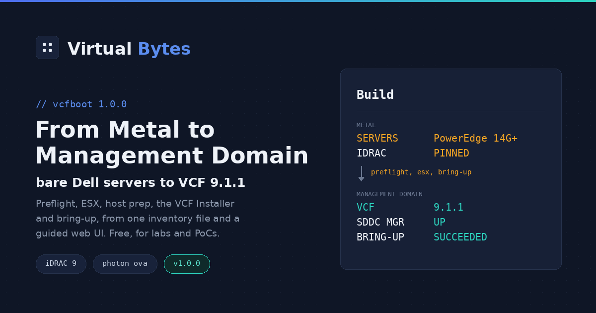

<p align="center">
  
</p>

<h1 align="center">vcfboot</h1>

<p align="center">
  <strong>Bare Dell PowerEdge servers to a VMware Cloud Foundation 9.1.1 management domain.</strong><br>
  One inventory, one guided web UI, one appliance. By <a href="https://virtualbytes.io">Virtual Bytes</a>.
</p>

<p align="center">
  <a href="../../releases/latest"></a>
  
  
  
</p>

> [!WARNING]
> **For labs and proofs of concept, not production.** vcfboot is not affiliated with, endorsed by or supported by Broadcom (VMware), Dell or Microsoft.
> Installing ESX **erases the boot device and, with vSAN, the data drives** of every server it builds. Point it only at servers you mean to rebuild.

---

## Why vcfboot

Building a VCF management domain by hand is a long list of small jobs: mount an ISO on every iDRAC, install ESX, set hostnames, DNS, NTP and SSH on each host, regenerate certificates, deploy the VCF Installer, set its depot, download bundles, write the bring-up spec, fix what validation finds, then wait for bring-up. vcfboot does all of it, in order, from one inventory, and stops only where it needs you.

| | |
| --- | --- |
| 🔎 **Preflight** | Reads every server through its iDRAC (Redfish): model, CPUs, memory, boot device, NVMe disks, ports. Checks them against what VCF needs before anything changes. |
| 💿 **ESX install** | Builds a per-host ISO from *your* ESX installer with a kickstart and boots it over iDRAC virtual media. Nothing else in the image is changed. |
| 🛠️ **Host prep** | Hostname, DNS, NTP, SSH and a certificate that matches the name: each host the way the VCF Installer validates it. |
| 📦 **VCF Installer** | Deploys it, sets the depot (Activation Code or offline depot) and downloads the bundles. |
| 🚀 **Bring-up** | Renders the spec from the inventory, validates it and runs bring-up on **vSAN ESA** or **NFS**, following its milestones to the end. |
| 🌐 **DNS, NTP and a DC** *(optional)* | No DNS or NTP in the lab yet? vcfboot answers both, then builds a Windows Server domain controller to take them over. |
| ➕ **Add a host** | After bring-up, installs and prepares another host, with a checklist for commissioning it in SDDC Manager. |

## Download

Get the OVA from **[Releases](../../releases/latest)**:

| File | |
| --- | --- |
| `vcfboot-<version>.ova` | The appliance |
| `vcfboot-<version>.ova.sha256` | Its checksum |
| `vcfboot-packages-<version>.txt` | Every Photon OS package in the appliance, with its version |

Check the download before you deploy it:

```bash
sha256sum -c vcfboot-1.0.0.ova.sha256
```

## What you need

**Hardware**

- Dell PowerEdge **14th generation or newer** (iDRAC 9 and later): 14th-generation servers such as the R640 and R740xd, and newer generations such as the R650, R750, R660 and R760. It was built and tested on the R640 and R740xd.
- One or two servers for a lab build, three or four for a production-like one.
- Cascade Lake CPUs or newer. ESX 9.1 calls Skylake unsupported: vcfboot installs on Skylake only in lab mode.

> [!NOTE]
> **Coming soon: HPE iLO.** Support for HPE ProLiant servers through iLO is on the way.

**Your own media.** The appliance ships no Broadcom, VMware or Microsoft software. You bring:

- the ESX 9.1.1 installer ISO;
- the VCF Installer OVA (9.1.1);
- your VCF Activation Code, or an offline depot;
- for the optional domain controller, a Windows Server 2025 ISO and its licence.

**A place to run it.** Any vCenter or ESX host (or Workstation/Fusion) that can reach the servers' iDRACs, the ESX management network and the addresses the VCF appliances will take. The VM is small: **2 vCPUs, 4 GB of memory**, a 20 GB system disk and a thin-provisioned **200 GB data disk** for your media.

## Deploy

Deploy the OVA with **Deploy OVF Template** in vCenter, or with `govc import.ova`, and fill in:

| Property | |
| --- | --- |
| Admin password | 12 characters or more. The `admin` login for the web UI and the console. |
| Enable SSH | Off by default. When on, `admin` can log in over SSH; root never can. |
| FQDN | The appliance's name; its TLS certificate is issued for it. |
| IPv4 address / prefix | For example `10.0.10.20/24`. Leave it empty for DHCP. |
| Default gateway | Needed with a static address. |
| DNS servers, NTP servers | Comma-separated. Use the DNS servers that hold (or will hold) the VCF records. |

Power it on. The console shows the UI's address and the **SHA-256 fingerprint** of its certificate: check it against what your browser shows.

<details>
<summary><strong>VMware Workstation or Fusion</strong></summary>

There is no OVF environment there. Before the first power-on, set the same values as `guestinfo` keys in the VM's `.vmx` file:

```
guestinfo.vcfboot.fqdn = "vcfboot.lab.example.com"
guestinfo.vcfboot.ip_cidr = "10.0.10.20/24"
guestinfo.vcfboot.gateway = "10.0.10.1"
guestinfo.vcfboot.dns = "10.0.10.5"
guestinfo.vcfboot.ntp = "10.0.10.5"
```

Without an admin password, the appliance makes a one-time password and shows it on the console. With no settings at all it comes up on DHCP.
</details>

### Change the admin password after the first boot

vCenter keeps the deployment password in the VM's vApp properties, where processes in the guest can read it through VMware Tools. Log in on the console (or over SSH) as `admin` and set a new one:

```bash
sudo vcfboot-passwd
```

Then clear the old one in vCenter under *Edit Settings › vApp Options*. Until you do, the UI shows a warning on every page.

## Build your domain

Open `https://<fqdn>/` and log in as `admin`. On the first login the **guided setup** opens:

1. **Start:** a *lab* build (one or two servers, VCF's lab settings) or a *production-like* one (three or four servers, built as a production domain would be). Existing DNS and NTP, or a domain controller that vcfboot builds.
2. **Network:** domain, DNS, NTP and the management network. vcfboot suggests vMotion, vSAN and overlay networks, and tests every DNS and NTP server and gateway from the appliance.
3. **Servers:** each iDRAC's address. vcfboot shows the iDRAC's certificate fingerprint and sends the login only once you trust it, then reads the server and runs its checks.
4. **Names and DNS:** every appliance's name and address, checked against DNS (A and PTR) and the network. Missing records come as ready-to-paste Windows DNS PowerShell or BIND lines.
5. **Passwords and build:** one VCF password, your media, the depot, and the erase confirmation.

Upload the ESX ISO and the VCF Installer OVA on **Your media** (with the SHA-256 from each download page), then press **Build my VCF domain**.

The **Build** page runs every stage in order: preflight, ESX, host prep, the installer, the depot, the bundles, the spec, bring-up and, if chosen, the domain controller. It shows a pipeline, the stack being built and bring-up's milestones. It stops only for:

- the erase confirmation, for hosts that still need ESX;
- the **Activation Code**, shown next to the installer's machine ID;
- validation warnings, each with its own *Accept* box. You can accept the ones you expect before the build starts, then walk away.

A failed step is retried with **Try again**, which skips what is done. A failed bring-up resumes from the failed task. When it finishes, the **Hand-off report** lists what was built.

Typical times, for planning: about 18 minutes of ESX install per host, about 20 minutes of bundle download, and around 3 hours of bring-up.

## Security

vcfboot holds the keys to a site, so it is careful with them:

- **Passwords in memory only.** iDRAC, ESX root and VCF passwords are never written to disk.
- **Pinned certificates.** Credentials go only to an iDRAC, host or appliance presenting the certificate vcfboot has pinned. When bring-up replaces the installer's certificate, the new one is accepted only if it chains to vCenter's pinned VMCA root.
- **A hardened appliance.** The UI runs unprivileged behind nginx, with an nftables firewall, root login disabled and SSH off by default.
- **Signed updates.** The appliance accepts update bundles signed with the project's Ed25519 key only (*Settings › Appliance updates*).
- **Tested.** The appliance was security-tested before release; the findings are fixed in 1.0.0.

Run the appliance on a management network only administrators can reach. To report a vulnerability, use **[Security › Report a vulnerability](../../security/advisories/new)** on this repository. Please don't open a public issue for it.

## Help and feedback

- **Bugs and questions:** [open an issue](../../issues). Include the version (top bar of the UI, or *Settings › Appliance updates*), the step and what its log says.
- **Ran it on other hardware?** I would like to hear how it went.
- Blog: [virtualbytes.io](https://virtualbytes.io)

## Licence

vcfboot is © Virtual Bytes and [MIT licensed](LICENSE). The appliance includes third-party software under its own licences: see [THIRD-PARTY-LICENSES.md](THIRD-PARTY-LICENSES.md), including how to get the source of the Photon OS packages.

<sub>VMware, VMware Cloud Foundation, VCF, ESX, vSAN, vCenter and NSX are trademarks of Broadcom. Dell, PowerEdge and iDRAC are trademarks of Dell Inc. HPE, ProLiant and iLO are trademarks of Hewlett Packard Enterprise. Windows Server is a trademark of Microsoft. vcfboot is not affiliated with, endorsed by or supported by Broadcom, Dell, HPE or Microsoft.</sub>
